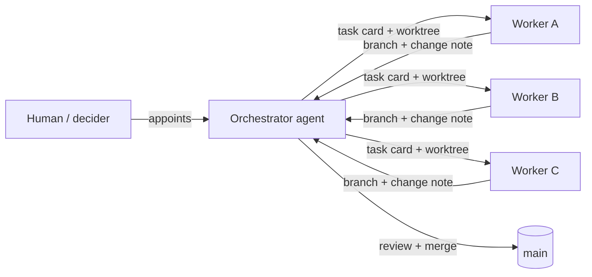

# Orchestrator Playbook


[](https://github.com/sakyaroy-007/orchestrator-playbook/stargazers)
[](LICENSE)

**A skill for running a software project with one orchestrator agent and several worker agents.**

The orchestrator plans, writes self-contained task cards, dispatches them to workers running in parallel git worktrees, reviews every branch personally, and is the only one who merges. All state lives in files inside the repository, so the orchestrator can be handed off between sessions, models, or even different agent tools.

Extracted from a real project that shipped this way, then generalized.

## Table of contents

- [How it works](#how-it-works)
- [Install](#install)
- [Quick start](#quick-start)
- [The start gate](#the-start-gate)
- [Handing off the orchestrator role](#handing-off-the-orchestrator-role)
- [Model choice](#model-choice)
- [What's inside](#whats-inside)
- [Requirements](#requirements)
- [Safety](#safety)
- [Contributing](#contributing)
- [License](#license)

## How it works



1. **Control plane in the repo.** Plans, task cards, a status board, a decision ledger, reviews and a handoff document live under `docs/plan/` and `.orchestrator/`. Only the orchestrator writes them.
2. **One card, one worktree, one branch.** Workers write only inside `<repo>-wt/<card>`, commit to `t/<number>-<slug>`, and add a change note under `docs/changes/`.
3. **The orchestrator does not trust self-reports.** Every returned branch is re-run against the card's acceptance commands, diffed in full, and checked for scope creep, fake tests, leaked secrets, and irreversible operations.
4. **The orchestrator is the only integrator.** It merges with `--no-ff`, runs the full suite on the main branch, pushes, updates the docs, and removes the worktree.
5. **The role can change hands.** `.orchestrator/TEAM.md` records the current holder. Only the human may change it; the outgoing orchestrator writes a handoff, the incoming one verifies the live state and claims the role.

## Install

### Claude Code

```bash
/plugin marketplace add sakyaroy-007/orchestrator-playbook
/plugin install orchestrator-playbook --marketplace sakyaroy-007/orchestrator-playbook
```

### Codex

The repository ships a `.codex-plugin/plugin.json` manifest. If your Codex build installs plugins from a git URL, point it at this repository. Otherwise use the symlink method below.

### skills.sh / skills CLI

```bash
npx skills add sakyaroy-007/orchestrator-playbook
```

skills.sh lists a skill automatically once people install it through the CLI (anonymous install telemetry).

### Any other client

Copy or symlink this directory into the agent's skills directory:

```bash
git clone https://github.com/sakyaroy-007/orchestrator-playbook.git
ln -s "$PWD/orchestrator-playbook" ~/.claude/skills/orchestrator-playbook   # Claude Code
ln -s "$PWD/orchestrator-playbook" ~/.agents/skills/orchestrator-playbook   # Codex / shared root
```

The skill is **explicit-invocation only** (`disable-model-invocation: true` in `SKILL.md`, `allow_implicit_invocation: false` in `agents/openai.yaml`). It should never fire on its own.

## Quick start

```bash
# 1. Scaffold the control plane inside your repo (dry-run first if you like)
bash scripts/init-plan.sh /path/to/repo --project MyProject --decider "Your Name" --orchestrator "My Agent"

# 2. Fill the blanks
grep -rn '【待填' /path/to/repo/docs/plan /path/to/repo/.orchestrator

# 3. Create the first card's worktree; it prints the preflight and dispatch prompts
cd /path/to/repo && scripts/wt.sh new T-001 first-card

# 4. Dispatch (Claude Code, Codex, Hermes, DeepSeek Harness, or your own scheduler)
scripts/dispatch.sh claude /path/to/repo-wt/T-001 "Read docs/plan/WORKER.md and docs/plan/tasks/T-001.md, work in this worktree, and report back with the WORKER.md template."
```

## The start gate

Reading this skill does **not** make an agent the orchestrator. Before doing anything orchestration-related, an agent must satisfy one of:

1. the human appointed it in this session;
2. `.orchestrator/TEAM.md` names it as the current holder;
3. it is explicitly taking over from a previous orchestrator.

Otherwise it is a worker (or just an assistant), and must not write the control plane, dispatch work, or merge. This gate is enforced in three places: the description, the client manifests, and section 0 of `SKILL.md`.

## Handing off the orchestrator role

The role changes hands often: quota runs out, models change, tools change. The procedure lives in `SKILL.md` ("换总指挥") and `references/handoff-files.md`:

1. the **human** names the new holder (agents cannot self-appoint);
2. the outgoing orchestrator writes the handoff into `HANDOFF.md`, moves private memory into the repo, updates `.orchestrator/TEAM.md`, commits and pushes;
3. the incoming orchestrator reads, verifies the live state, claims the role in `TEAM.md`, and reports back.

## Model choice

This skill does not depend on any model provider, gateway, or routing service. The user chooses the models; the playbook only recommends stronger models and heavier review for high-risk cards (money, auth, isolation).

## What's inside

| Path | Purpose |
|---|---|
| `SKILL.md` | The skill itself (English) |
| `SKILL.zh.md` | Chinese edition of the skill |
| `AGENTS.md` | Rules for agents editing **this repository** (not its users) |
| `CHANGELOG.md` | Release history |
| `references/bootstrap.md` | Start a project, take over as orchestrator, per-session checklists |
| `references/handoff-files.md` | `.orchestrator/TEAM.md` / `PLAYBOOK.md`: how to hand off cleanly |
| `references/cards.md` | How to split and write task cards, spikes, anti-cheat acceptance commands |
| `references/dispatch.md` | Preflight checks, dispatch channels, worker management |
| `references/review.md` | Review checklist, mutation testing, independent review, merge pipeline |
| `references/stakeholder.md` | Decision ledger, external items, how to ask the human |
| `references/lessons.md` | 19 hard-won pitfalls |
| `templates/` | Control-plane files with `{{placeholders}}` and `【待填】` markers |
| `scripts/init-plan.sh` | Scaffold the control plane in a repo (never overwrites) |
| `scripts/wt.sh` | One worktree per card: `new` / `ls` / `path` / `rm` |
| `scripts/dispatch.sh` | Dispatcher for Claude / Codex / Hermes / DeepSeek Harness |
| `scripts/selftest.sh` | 73-check end-to-end test of the scripts (temp repos only) |

`references/*.md` are English; `references/*.zh.md` are the Chinese editions. `templates/` are still Chinese — placeholders use the marker `【待填】`, which means "to fill". Translations of templates are welcome.

## Requirements

`git`, `bash` (macOS 3.2 works), `perl` or `timeout`, `sed`, `awk`. No network access, no sudo, no dependencies.

## Safety

- `init-plan.sh` never overwrites existing files.
- `wt.sh rm` refuses to delete unmerged or dirty worktrees unless `--force`.
- `dispatch.sh` never widens permissions for you; anything the worker CLI needs goes after `--`.
- All tests run in throwaway repos under the system temp directory.

## Contributing

Issues and pull requests are welcome. Run `scripts/selftest.sh` before sending a change to any script; it must stay green. If you have shipped this workflow in another project, tell us which part broke and how you fixed it — the `references/lessons.md` file is the most valuable part to grow.

## License

MIT. See [LICENSE](LICENSE).
