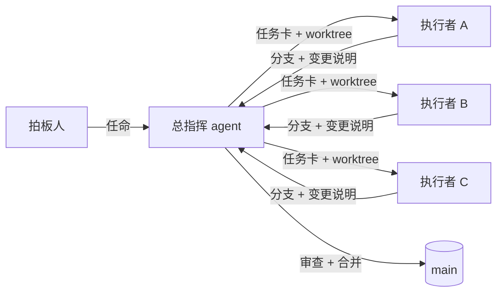

# Orchestrator Playbook（总指挥打法）


[English](README.md) | **简体中文**

[](https://github.com/sakyaroy-007/orchestrator-playbook/stargazers)
[](LICENSE)

**一个让「总指挥 agent + 多个执行者 agent」协作开发软件项目的 skill。**

总指挥负责计划、把工作拆成自包含的任务卡、派发给在并行 git worktree 里干活的执行者，并亲自审查每一个分支——它是唯一做合并的人。所有状态都落在仓库文件里，所以总指挥可以在会话、模型、甚至不同 agent 工具之间交接，而不丢上下文。

这套方法提炼自一个真实项目，跑通之后做了通用化。

## 目录

- [怎么运作](#怎么运作)
- [安装](#安装)
- [快速开始](#快速开始)
- [启动门](#启动门)
- [换总指挥](#换总指挥)
- [模型选择](#模型选择)
- [仓库内容](#仓库内容)
- [依赖](#依赖)
- [安全边界](#安全边界)
- [贡献](#贡献)
- [许可证](#许可证)

## 怎么运作



1. **控制面放在仓库里**。计划、任务卡、看板、决策台账、审查意见、交接文档都在 `docs/plan/` 和 `.orchestrator/` 下，只有总指挥写。
2. **一卡一 worktree 一分支**。执行者只在 `<repo>-wt/<卡号>` 里写，只提交到 `t/<编号>-<slug>`，另写一份 `docs/changes/` 变更说明。
3. **总指挥不接受自报**。每张卡回来都要复跑验收命令、读完整 diff，查越界、假测试、密钥残留、不可逆操作。
4. **只有总指挥合并**。`--no-ff` 合入 main，在 main 上跑全量测试，推送，更新文档，清掉 worktree。
5. **角色可以换人**。`.orchestrator/TEAM.md` 记录当前 holder；只有拍板人能改。旧总指挥写交接，新总指挥核实现场后认领。

## 安装

### Claude Code

```bash
/plugin marketplace add sakyaroy-007/orchestrator-playbook
/plugin install orchestrator-playbook --marketplace sakyaroy-007/orchestrator-playbook
```

### Codex

仓库带 `.codex-plugin/plugin.json` 清单。如果你的 Codex 支持从 git URL 安装插件，直接指向本仓库；否则用下面的软链方式。

### skills.sh / skills CLI

```bash
npx skills add sakyaroy-007/orchestrator-playbook
```

skills.sh 没有人工提交入口：有人通过 CLI 安装后，安装遥测会自动把它带进排行榜。

### 其他客户端

把本目录复制或软链到对应 agent 的 skills 目录：

```bash
git clone https://github.com/sakyaroy-007/orchestrator-playbook.git
ln -s "$PWD/orchestrator-playbook" ~/.claude/skills/orchestrator-playbook   # Claude Code
ln -s "$PWD/orchestrator-playbook" ~/.agents/skills/orchestrator-playbook   # Codex / 共享根目录
```

本 skill 是**显式调用**的（`SKILL.md` 里 `disable-model-invocation: true`，`agents/openai.yaml` 里 `allow_implicit_invocation: false`），不会自己触发。

## 快速开始

```bash
# 1. 在仓库里铺控制面（可先加 --dry-run 预览）
bash scripts/init-plan.sh /path/to/repo --project MyProject --decider "你的名字" --orchestrator "你的 agent"

# 2. 填掉占位符
grep -rn '【待填' /path/to/repo/docs/plan /path/to/repo/.orchestrator

# 3. 建第一张卡的 worktree（会打印预检口令和派发口令）
cd /path/to/repo && scripts/wt.sh new T-001 first-card

# 4. 派发（Claude Code / Codex / Hermes / DeepSeek Harness，或你自己的调度器）
scripts/dispatch.sh claude /path/to/repo-wt/T-001 "读 docs/plan/WORKER.md 和 docs/plan/tasks/T-001.md，在这个 worktree 里干活，完成后按 WORKER.md 模板回报。"
```

## 启动门

**读到这个 skill，不等于你是总指挥。** 动手之前，必须满足以下任意一条：

1. 拍板人在本次会话里任命了你；
2. `.orchestrator/TEAM.md` 记录的当前 holder 就是你；
3. 你正在明确地从上一任总指挥手中接任。

否则你只是执行者（或普通助手）：不许写控制面、不许派活、不许合并。这道门在三个地方同时生效：description、客户端清单、`SKILL.md` 第 0 节。

## 换总指挥

总指挥一定会换：额度耗尽、换模型、换工具、换人。流程在 `SKILL.md`（「换总指挥」）和 `references/handoff-files.md`：

1. **拍板人**指定新 holder（agent 不能自我任命）；
2. 旧总指挥把交接写进 `HANDOFF.md`，把私有记忆搬进仓库，更新 `.orchestrator/TEAM.md`，提交并推送；
3. 新总指挥按顺序读、核实现场、在 `TEAM.md` 认领，然后给拍板人一段话的接手报告。

## 模型选择

本 skill 不依赖任何模型供应商、网关或路由服务。模型由用户自选；playbook 只建议：高风险卡（钱 / 鉴权 / 隔离）用更强的模型，并做更重的审查。

## 仓库内容

| 路径 | 用途 |
|---|---|
| `SKILL.md` | skill 本体（英文） |
| `SKILL.zh.md` | skill 中文版 |
| `AGENTS.md` | 给**维护本仓库**的 agent 的规则（不是给使用者的） |
| `CHANGELOG.md` | 发布历史 |
| `references/bootstrap.md` | 新项目开局、接手总指挥、会话检查清单 |
| `references/handoff-files.md` | `.orchestrator/TEAM.md` / `PLAYBOOK.md`：怎么做干净交接 |
| `references/cards.md` | 拆卡、写卡、spike、防作弊的验收命令 |
| `references/dispatch.md` | 预检、派发通道、执行者管理 |
| `references/review.md` | 审查清单、变异检验、独立审查、合并流水线 |
| `references/stakeholder.md` | 决策台账、外部事项、怎么问拍板人 |
| `references/lessons.md` | 19 条踩坑实录 |
| `templates/` | 带 `{{占位符}}` 和 `【待填】` 标记的控制面模板 |
| `scripts/init-plan.sh` | 在仓库里铺控制面（不覆盖已有文件） |
| `scripts/wt.sh` | 一卡一 worktree：`new` / `ls` / `path` / `rm` |
| `scripts/dispatch.sh` | 通用派发器：Claude / Codex / Hermes / DeepSeek Harness |
| `scripts/selftest.sh` | 73 项脚本端到端自测（只在临时仓库里跑） |

`references/*.md` 是英文；`references/*.zh.md` 是对应的中文版。`templates/` 目前是中文，占位符标记为 `【待填】`。欢迎翻译。

## 依赖

`git`、`bash`（macOS 3.2 可用）、`perl` 或 `timeout`、`sed`、`awk`。不联网、不需要 sudo、无第三方依赖。

## 安全边界

- `init-plan.sh` 从不覆盖已有文件。
- `wt.sh rm` 在分支未合并或有未提交改动时拒绝删除（除非 `--force`）。
- `dispatch.sh` 不会替你放宽任何权限；执行者 CLI 需要的权限放在 `--` 后面。
- 所有测试都在系统临时目录里的临时仓库中运行。

## 贡献

欢迎 issue 和 PR。改任何脚本前先跑 `scripts/selftest.sh`，必须保持全绿。如果你在别的项目里用过这套方法，告诉我们哪一环坏了、你怎么修的——`references/lessons.md` 是最值得长大的部分。

## 许可证

MIT，见 [LICENSE](LICENSE)。
